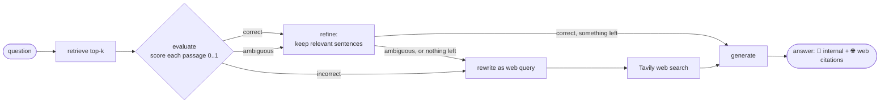

# Corrective RAG (CRAG)

**Check whether retrieval worked, correct it if not, and fall back to the web.** [CRAG (Yan et al., 2024)](https://arxiv.org/abs/2401.15884) puts a *retrieval evaluator* between retrieval and generation. Each retrieved passage gets a relevance score from 0 to 1, and two thresholds turn the scores into **one of three actions**:

| Action | When | What happens |
|---|---|---|
| ✅ **Correct** | any passage ≥ `UPPER_THRESHOLD` (0.7) | Keep the passages and **refine** each to the sentences that bear on the question |
| 🔀 **Ambiguous** | in between | Refine the passages that aren't clearly wrong **and** add web results |
| 🌐 **Incorrect** | every passage < `LOWER_THRESHOLD` (0.3) | **Discard** all internal passages, rewrite the question as a web query, search the web |

Built with **LangGraph**, **OpenAI** (`gpt-4o-mini`) as both evaluator and generator, and **Tavily** for web search.



## How it differs from [self-rag](../self-rag/)

| | self-rag | corrective-rag |
|---|---|---|
| Grading | Binary relevant/irrelevant, then support and usefulness checks on the *answer* | Graded **confidence score** per passage → three-way action; no answer checks |
| When internal docs fail | Rewrites the query and searches **the same index** again | Goes **outside**: web search (Tavily) |
| Context | Whole relevant chunks | **Knowledge refinement**: only the relevant sentences of each kept chunk |
| Control flow | Cycles (bounded loops) | A one-pass DAG with branches |

## Design notes

- **The thresholds are the main knob.** Raising `UPPER_THRESHOLD` sends more questions to the web. Raising `LOWER_THRESHOLD` discards more internal passages. Under the hood shows each passage's score and reason next to the action, so the cut-offs can be tuned against real questions.
- **Refinement can empty the context.** If no sentence of any kept passage helps, the graph treats that like a failed retrieval and goes to the web instead of answering from nothing.
- **Web search degrades gracefully:**
  - No `TAVILY_API_KEY`, or `WEB_SEARCH=false`: the web step is skipped. The UI and trace say why, and no web-query rewrite is spent.
  - A Tavily error (bad key, quota, timeout) is recorded in the trace, and the answer uses whatever internal knowledge survived.
  - With nothing usable at all, it answers "I don't know" without an LLM call.
- **Provenance is kept.** Web passages carry `web=True`, their URL and title. The answer prompt labels them `(web: url)` and tells the model to prefer internal documents when they conflict. The UI shows 📄 and 🌐 sources differently.
- **Scores are clamped to [0, 1]** in case the evaluator returns something out of range.

## Stack

| Part | Choice |
|---|---|
| Orchestration | **LangGraph** 1.x `StateGraph` with conditional edges |
| LLM | **OpenAI** `gpt-4o-mini` (evaluator via `with_structured_output`, refiner, web-query rewriter, generator) |
| Web search | **Tavily** (`tavily-python`), `WEB_RESULTS` results per query |
| Retrieval | LangChain vector-store integrations: `chroma` (default), `faiss`, `qdrant-local`, `lancedb`, `pinecone`, `qdrant-cloud`, `weaviate-cloud` |
| Embeddings | LangChain integrations: `openai`, `gemini` (768-d), `cohere`, `voyage`, `huggingface` (default `BAAI/bge-small-en-v1.5`, local) |
| UI | Streamlit: action badge, 📄 vs 🌐 sources with links, per-passage scores under the hood |

## Run

```bash
uv sync                                 # default stack: HF embeddings + Chroma
cp .env.example .env                    # set OPENAI_API_KEY (+ TAVILY_API_KEY for web fallback)
uv run python -m corrective_rag.ingest  # index ../sample_data
uv run streamlit run app.py
```

Try these:
- "What does the X1 robot cost?" → correct.
- "Is Nimbus Robotics publicly traded?" → incorrect, then web.
- Something half-covered, such as "How does the S2 compare to competitors' warehouse robots?" → ambiguous.

Optional extras: `uv sync --extra faiss`, `qdrant`, `lancedb`, `pinecone`, `weaviate`, `gemini`, `cohere`, `voyage`, or `--extra all`. With pip: `pip install -r requirements.txt` and `pip install -e .`.

## Configuration

| Variable | Default | Notes |
|---|---|---|
| `OPENAI_API_KEY` | – | Required (LLM; also `openai` embeddings) |
| `LLM_MODEL` | `gpt-4o-mini` | Evaluator, refiner, rewriter and generator |
| `UPPER_THRESHOLD` / `LOWER_THRESHOLD` | `0.7` / `0.3` | Must satisfy lower ≤ upper |
| `REFINE_KNOWLEDGE` | `true` | One extra LLM call per kept passage |
| `TAVILY_API_KEY` | – | Enables the web fallback |
| `WEB_SEARCH` / `WEB_RESULTS` | `true` / `3` | |
| `EMBEDDING_PROVIDER` / `EMBEDDING_MODEL` | `huggingface` / provider default | `openai \| gemini \| cohere \| voyage \| huggingface` |
| `GEMINI_API_KEY` / `COHERE_API_KEY` / `VOYAGE_API_KEY` | – | That embedding provider |
| `VECTOR_STORE` | `chroma` | Local: `chroma \| faiss \| qdrant-local \| lancedb`; cloud: `pinecone \| qdrant-cloud \| weaviate-cloud` |
| `INDEX_DIR`, `DATA_DIR`, `TOP_K`, `CHUNK_SIZE`, `CHUNK_OVERLAP` | `.index`, `../sample_data`, `4`, `1000`, `150` | |
| `EVAL_LLM`, `ANTHROPIC_API_KEY`, `EVAL_JUDGE_MODEL` | `gpt-4o-mini`, –, `claude-sonnet-5-5` | Evaluation only |

## Tests

```bash
uv sync --extra all --extra dev
uv run pytest -q          # offline: bag-of-words embedding, scripted evaluator, fake web client
uv run ruff check . && uv run ruff format --check .
```

`tests/test_pipeline.py` covers every route through the graph:
- The threshold table, including the edge cases.
- Correct means no web call. Incorrect discards internal passages and searches the web with the *rewritten* query. Ambiguous merges internal and web passages.
- Refinement replaces passage text, and refinement that removes everything leads to the web.
- With no web client, it gives an "I don't know" without generating. A Tavily error degrades gracefully.
- Scores are clamped.

`tests/test_llm.py` checks how Tavily results are mapped and how its errors are wrapped.

## Evaluation

```bash
uv sync --extra all --extra eval
uv run python eval/run_eval.py     # fair mode; needs OPENAI_API_KEY + ANTHROPIC_API_KEY (+ TAVILY_API_KEY)
python ../scripts/compare.py       # refresh the root README table
```

Fair mode uses the common `gpt-4o-mini` for the evaluator and the generator, with `bge-small` and `chroma`. Web search stays on when a Tavily key is set, because it's part of the technique. `results.json` records each question's CRAG action and graph path. Note that RAGAS context metrics are computed against references written from `sample_data`, so web-answered questions can score low on context precision even when the answer is right.

<!-- EVAL_RESULTS -->
_Not run yet. Run `eval/run_eval.py` with your keys._
<!-- /EVAL_RESULTS -->

## Limitations

- **Evaluator cost.** There is one scoring call per retrieved passage plus one refine call per kept passage, so keep `TOP_K` small. The paper uses a fine-tuned T5 evaluator; an LLM is slower but needs no training.
- **The web is untrusted.** Results may be wrong, stale or adversarial. Internal sources are preferred on conflict, but the model can still repeat a bad web claim.
- **Privacy.** In the ambiguous and incorrect paths, a rewritten form of the user's question is sent to Tavily. Turn it off with `WEB_SEARCH=false` for sensitive deployments.
- **Fixed thresholds.** They don't adapt per question type (see [adaptive-rag](../adaptive-rag/) for routing).
