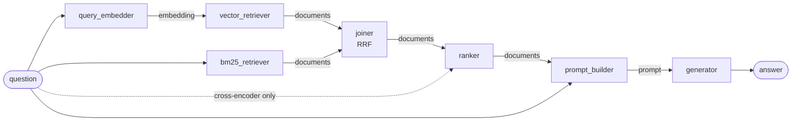

# Modular RAG

**Retrieval, ranking and generation as interchangeable parts.** Each stage is a module with a fixed interface, and a **Haystack** `Pipeline` is assembled from whichever modules you pick: per deployment in `.env`, or per question in the UI sidebar. Swap one part and the rest of the system doesn't change. Built on **Haystack 3** and **Mistral**.

| Stage | Interface | Modules |
|---|---|---|
| **Retriever** | `query` → `documents` (`CANDIDATE_K`) | `vector`: dense search on any of the 7 stores (custom components) · `bm25`: Haystack `InMemoryBM25Retriever` over the chunk corpus · `hybrid`: both, fused with a `DocumentJoiner` (reciprocal rank fusion) |
| **Ranker** | `documents` → top `TOP_K` | `none`: keep the order · `cross-encoder`: re-score each (query, passage) pair · `lost-in-the-middle`: Haystack `LostInTheMiddleRanker`, best passages at the start and end of the prompt |
| **Generator** | `messages` → `replies` | `mistral`: `MistralChatGenerator` · `openai`: `OpenAIChatGenerator` |



*This is the `hybrid` pipeline. The app draws the actual graph for the selected modules with Graphviz, and the trace includes it as Mermaid.*

## Swapping modules on the sample data

"When is customer support available?" The FAQ holds the support hours. Run with local `bge-small` and the real cross-encoder:

| Retriever + ranker | Top 4 sources |
|---|---|
| vector + none | support_tickets.csv · **faq.html** · support_tickets.csv · company_overview.md |
| bm25 + none | **faq.html** · org_chart.png · release_notes.txt · q3_report.pdf |
| hybrid + none | **faq.html** · company_overview.md · release_notes.txt · support_tickets.csv |
| hybrid + cross-encoder | **faq.html** · company_overview.md · employee_handbook.docx · org_chart.png |

Dense search alone puts the tickets first, because they *talk about* support. Keyword matching finds the page with the hours, and hybrid gets the best of both. **Under the hood** shows each stage's output (vector hits, BM25 hits, joined list, ranked list), so the effect of every swap is visible.

## Design notes

- **One cached pipeline per module combination.** `ModularRAG.pipeline_for(Modules(...))` builds on first use with `add_component` and `connect`, and records every edge for the diagrams. After ingest, `refresh_corpus()` reloads BM25 and drops pipelines built on the old corpus.
- **Custom components wrap this folder's own embedders and stores**, so `vector` works with all 5 embedding providers and all 7 stores. `QueryEmbedder` and `StoreRetriever` are ordinary `@component` classes, the way Haystack expects you to extend it.
- **BM25 needs text, not vectors.** Ingest writes the same chunks it indexes to `INDEX_DIR/corpus.jsonl`, deduplicated by chunk id on append. Asking for `bm25` or `hybrid` without a corpus gives a clear "click Index DATA_DIR" message.
- **Haystack 3 note:** Haystack 3 moved `SentenceTransformersSimilarityRanker` out of core into `sentence-transformers-haystack`. That package needs a newer `openai` than ragas (the eval extra) allows, so the `cross-encoder` module is a small custom component over `sentence_transformers.CrossEncoder`: ~30 lines, the same model, and the same behaviour.
- **Deterministic generation:** `temperature=0` on both generator modules.

## Stack

| Part | Choice |
|---|---|
| Framework | **Haystack 3** (`haystack-ai`): `Pipeline`, `DocumentJoiner`, `InMemoryBM25Retriever`, `LostInTheMiddleRanker`, `ChatPromptBuilder` |
| LLM | **Mistral** `mistral-small-latest` (`mistral-haystack`); `openai` module `gpt-4o-mini` |
| Reranker | `cross-encoder/ms-marco-MiniLM-L-6-v2` (local, downloaded on first use) |
| Embeddings | Raw SDKs (as in [naive-rag](../naive-rag/)): `openai`, `gemini`, `cohere`, `voyage`, `huggingface` (default `BAAI/bge-small-en-v1.5`, local) |
| Vector store | Hand-written thin clients: `chroma` (default), `faiss`, `qdrant-local`, `lancedb`, `pinecone`, `qdrant-cloud`, `weaviate-cloud` |
| UI | Streamlit: module pickers in the sidebar, live Graphviz pipeline diagram, per-stage outputs under the hood |

## Run

```bash
uv sync                              # default stack: HF embeddings + Chroma
cp .env.example .env                 # set MISTRAL_API_KEY (OPENAI_API_KEY for the openai module)
uv run python -m modular_rag.ingest  # index ../sample_data (also writes the BM25 corpus)
uv run streamlit run app.py
```

Ask something, switch the retriever or ranker in the sidebar, and ask again. The answer header shows the modules used (`🧩 bm25 → lost-in-the-middle → mistral`).

Optional extras: `uv sync --extra faiss`, `qdrant`, `lancedb`, `pinecone`, `weaviate`, `gemini`, `cohere`, `voyage`, or `--extra all`. With pip: `pip install -r requirements.txt` and `pip install -e .`.

## Configuration

| Variable | Default | Notes |
|---|---|---|
| `MISTRAL_API_KEY` / `LLM_MODEL` | – / `mistral-small-latest` | `mistral` generator module |
| `OPENAI_API_KEY` / `OPENAI_MODEL` | – / `gpt-4o-mini` | `openai` generator module; also the fair-mode eval generator and `openai` embeddings |
| `RETRIEVER` / `RANKER` / `GENERATOR` | `hybrid` / `none` / `mistral` | Default modules |
| `CANDIDATE_K` | `8` | Retrieved before ranking (`TOP_K` kept after) |
| `RERANK_MODEL` | `cross-encoder/ms-marco-MiniLM-L-6-v2` | Any sentence-transformers cross-encoder |
| `EMBEDDING_PROVIDER` / `EMBEDDING_MODEL` | `huggingface` / provider default | `openai \| gemini \| cohere \| voyage \| huggingface` |
| `GEMINI_API_KEY` / `COHERE_API_KEY` / `VOYAGE_API_KEY` | – | That embedding provider |
| `VECTOR_STORE` | `chroma` | Local: `chroma \| faiss \| qdrant-local \| lancedb`; cloud: `pinecone \| qdrant-cloud \| weaviate-cloud` |
| `INDEX_DIR`, `DATA_DIR`, `TOP_K`, `CHUNK_SIZE`, `CHUNK_OVERLAP` | `.index`, `../sample_data`, `4`, `800`, `100` | |
| `EVAL_LLM`, `ANTHROPIC_API_KEY`, `EVAL_JUDGE_MODEL` | `gpt-4o-mini`, –, `claude-sonnet-5-5` | Evaluation only |

## Tests

```bash
uv sync --extra all --extra dev
uv run pytest -q          # offline: bag-of-words embedder, fake Haystack generator + cross-encoder
uv run ruff check . && uv run ruff format --check .
```

`tests/test_pipeline.py` builds and runs real Haystack pipelines with a fake generator component. It covers:
- Every retriever module's node path, and BM25 exact-keyword wins.
- Hybrid fusion deduplicating chunks.
- Cross-encoder re-ordering, and lost-in-the-middle keeping `TOP_K`.
- Generator swapping, numbered prompts, pipeline caching and invalidation, and both diagrams.
- Module validation, the missing-corpus message, and corpus append without duplicates.
- Generator key checks.

## Evaluation

```bash
uv sync --extra all --extra eval
uv run python eval/run_eval.py     # fair mode; needs OPENAI_API_KEY + ANTHROPIC_API_KEY
python ../scripts/compare.py       # refresh the root README table
```

Fair mode swaps in the `openai` generator module running the common `gpt-4o-mini`, with `bge-small` and `chroma`. It **keeps the retriever and ranker modules from `.env`**, so the score reflects that module choice. To compare combinations, change `RETRIEVER` / `RANKER` and re-run; `results.json` records the modules used.

<!-- EVAL_RESULTS -->
_Not run yet. Run `eval/run_eval.py` with your keys._
<!-- /EVAL_RESULTS -->

## Limitations

- **Module choice is manual.** Nothing picks the best combination per question (see [adaptive-rag](../adaptive-rag/) for routing).
- **The BM25 corpus is in memory.** Fine for thousands of chunks; for large corpora use a search engine (Elasticsearch / OpenSearch Haystack integrations).
- **The cross-encoder runs on CPU here** and adds roughly 50–200 ms per question at `CANDIDATE_K=8`. Raise `CANDIDATE_K` for recall at the cost of latency.
- **No query rewriting or answer checking.** Those modules exist in other folders ([advanced-rag](../advanced-rag/), [self-rag](../self-rag/)) and would plug in here behind the same interfaces.
