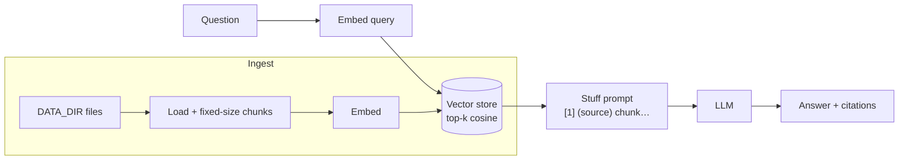

# Naive RAG

The baseline for every other RAG type in this repo. It embeds the question, takes the **top-k** most similar chunks, stuffs them into one prompt and generates an answer. There is no query rewriting, reranking, relevance filtering or answer checking. Each of those is what a later RAG type adds, and this folder is what they are measured against.



## What makes it naive

| Step | Naive RAG does | Missing (see) |
|---|---|---|
| Query | Uses the raw question | Rewriting → [self-rag](../self-rag/), [advanced-rag](../advanced-rag/) |
| Retrieval | One dense top-k search | Hybrid / rerank → [advanced-rag](../advanced-rag/), [modular-rag](../modular-rag/) |
| Context | Passes every hit unchanged | Relevance grading → [corrective-rag](../corrective-rag/) |
| Answer | Single generation | Self-check → [self-rag](../self-rag/) |
| Memory | None | → [simple-rag-memory](../simple-rag-memory/) |

## Stack

| Part | Choice |
|---|---|
| Framework | **None**: raw SDKs behind small protocols (`Embedder`, `VectorStore`, `LLM`) |
| LLM | OpenAI `gpt-4o-mini` (`temperature=0`) |
| Embeddings | `openai` · `gemini` · `cohere` · `voyage` · `huggingface` (default `BAAI/bge-small-en-v1.5`, local) |
| Vector store | `chroma` (default) · `faiss` · `qdrant-local` · `lancedb` · `pinecone` · `qdrant-cloud` · `weaviate-cloud` |
| Loaders | `.txt .md .pdf .docx .csv .xlsx .html`, plus images via `.txt` caption sidecars |
| UI | Streamlit, with an **Under the hood** panel (embed → retrieve scores → full prompt → model) |

## Run

```bash
uv sync                            # default stack: HF embeddings + Chroma
cp .env.example .env               # set OPENAI_API_KEY
uv run python -m naive_rag.ingest  # index ../sample_data
uv run streamlit run app.py
```

Other backends are optional extras: `uv sync --extra faiss`, `qdrant`, `lancedb`, `pinecone`, `weaviate`, `gemini`, `cohere`, `voyage`, or `--extra all`. With pip: `pip install -r requirements.txt` (includes all extras) and `pip install -e .`.

Each embedding model gets its **own index** (`naive-rag-<provider>-<model>`), so switching `EMBEDDING_PROVIDER` never mixes vectors. Opening an index with the wrong dimension gives a clear "re-index" error.

## Configuration

| Variable | Default | Notes |
|---|---|---|
| `OPENAI_API_KEY` | – | Required to generate answers |
| `LLM_MODEL` | `gpt-4o-mini` | |
| `EMBEDDING_PROVIDER` | `huggingface` | `openai \| gemini \| cohere \| voyage \| huggingface` |
| `EMBEDDING_MODEL` | provider default | |
| `GEMINI_API_KEY` / `COHERE_API_KEY` / `VOYAGE_API_KEY` | – | Only for that embedding provider |
| `VECTOR_STORE` | `chroma` | Local: `chroma \| faiss \| qdrant-local \| lancedb`; cloud: `pinecone \| qdrant-cloud \| weaviate-cloud` |
| `INDEX_DIR` | `.index` | Persistence for local stores |
| `PINECONE_API_KEY`, `PINECONE_CLOUD`, `PINECONE_REGION` | –, `aws`, `us-east-1` | |
| `QDRANT_URL`, `QDRANT_API_KEY` | – | `qdrant-cloud` |
| `WEAVIATE_URL`, `WEAVIATE_API_KEY` | – | `weaviate-cloud` |
| `DATA_DIR` | `../sample_data` | Any folder works |
| `TOP_K`, `CHUNK_SIZE`, `CHUNK_OVERLAP` | `4`, `800`, `100` | Characters, fixed windows |
| `EVAL_LLM`, `ANTHROPIC_API_KEY`, `EVAL_JUDGE_MODEL` | `gpt-4o-mini`, –, `claude-sonnet-5-5` | Evaluation only |

## Tests

```bash
uv sync --extra all --extra dev
uv run pytest -q          # offline, no API keys; cloud stores use in-memory fakes
uv run ruff check . && uv run ruff format --check .
```

## Evaluation

```bash
uv sync --extra eval
uv run python eval/run_eval.py     # fair mode; needs OPENAI_API_KEY + ANTHROPIC_API_KEY
python ../scripts/compare.py       # refresh the root README table
```

Fair mode fixes the generator (`gpt-4o-mini`), embeddings (`bge-small`) and store (`chroma`) for every RAG type. A Claude model judges with RAGAS: faithfulness, answer relevancy, context precision and context recall. Image questions are skipped (`n/a`) outside multimodal-rag.

<!-- EVAL_RESULTS -->
_Not run yet. Run `eval/run_eval.py` with your keys._
<!-- /EVAL_RESULTS -->

## Limitations

- Vague or multi-hop questions often miss a needed chunk, because only one query is embedded.
- Irrelevant top-k hits still reach the prompt and can pull the answer off track.
- Fixed character windows can split a fact across two chunks.
- Nothing checks the answer against the sources apart from the prompt instruction.
