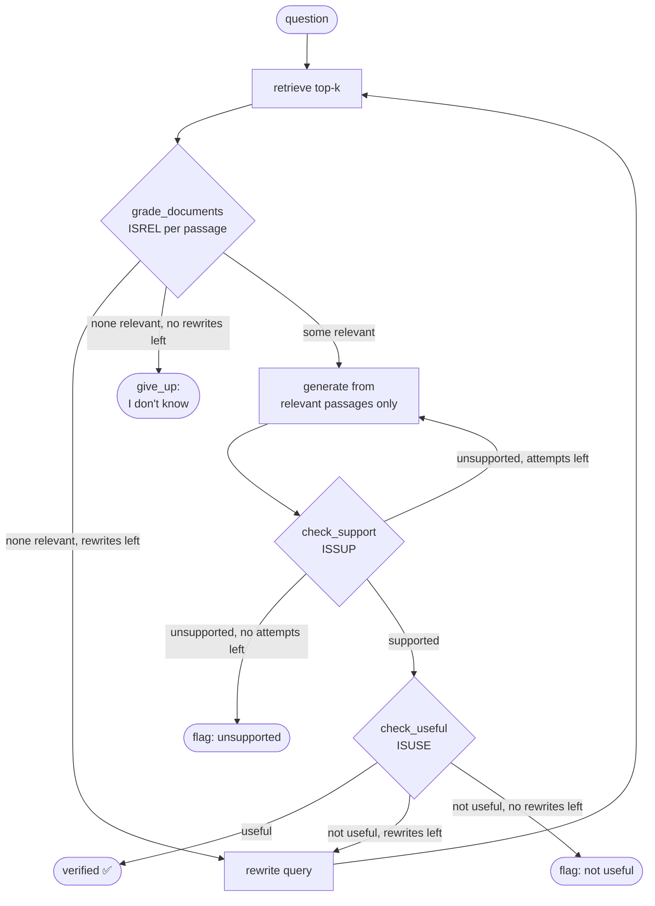

# Self-RAG

The model **critiques its own retrieval and its own answer, then loops**. [Self-RAG (Asai et al., 2023)](https://arxiv.org/abs/2310.11511) trains a model to emit reflection tokens:
- **ISREL**: is this passage relevant?
- **ISSUP**: is the answer supported by it?
- **ISUSE**: is the answer useful?

Here a **Claude grader plays those critics** inside a **LangGraph** state machine, with no fine-tuning. Weak retrieval triggers a query rewrite, an unsupported answer is regenerated with the grader's feedback, and when nothing relevant is ever found the graph says so instead of guessing.



Every answer ends with a **verdict** the UI shows as a badge: `verified`, `unsupported`, `not useful` or `no relevant documents`. Below the answer is a loop summary ("2 retrievals · 1 rewrite · 1 answer attempt"). **Under the hood** shows every node: each passage's relevance reason, the rewritten queries, each attempt's prompt, and the grader's list of unsupported claims.

## What it adds over the earlier folders

| | simple-rag … hyde-rag | self-rag |
|---|---|---|
| Control flow | One straight pipeline | **Graph with cycles** (LangGraph `StateGraph`, conditional edges) |
| Irrelevant hits | Stuffed into the prompt anyway | Graded per passage; dropped; rewrite + re-retrieve if none survive |
| Hallucinated claims | Shipped | Caught by the support check; regenerated with the claims named |
| Off-target answer | Shipped | Caught by the usefulness check; query rewritten |
| Nothing relevant exists | Model may guess | Explicit "I don't know" after `MAX_REWRITES` |
| Cost | 1 LLM call | `top_k` relevance grades + 1 answer + 2 checks per pass, more when it loops |

## Claude specifics

- **Official `anthropic` SDK, not a LangChain wrapper.** The graph nodes call a small `ClaudeLLM` class, which keeps the request shape explicit and tested (`tests/test_llm.py`).
- **No `temperature`.** Current Claude models run adaptive thinking and reject sampling parameters with a 400. Depth is set with `output_config.effort`: `LLM_EFFORT=medium` for answers, `GRADER_EFFORT=low` for the yes/no critics. `max_tokens` leaves room for thinking, which counts toward it.
- **Graders use JSON-schema structured output** (`output_config.format`), parsed into Pydantic models (`Relevance`, `Support`, `Usefulness`). They do not use forced tool calls, which current models reject.
- **Refusals are handled.** On models that support it, requests opt into the server-side refusal fallback (`fallbacks: "default"`, beta `server-side-fallback-2026-07-01`). If the whole chain still declines, the UI shows the reason instead of crashing.
- **Cost lever:** set `GRADER_MODEL=claude-haiku-5-5`. Grading is most of the calls (`top_k` + 2 per pass), and it's a simple yes/no task.

## Stack

| Part | Choice |
|---|---|
| Orchestration | **LangGraph** 1.x `StateGraph` (bounded cycles, conditional routing) |
| LLM | **Anthropic Claude** `claude-opus-5-5` via the `anthropic` SDK; graders same model at effort `low` (or `GRADER_MODEL`) |
| Retrieval | LangChain vector-store integrations: `chroma` (default), `faiss`, `qdrant-local`, `lancedb`, `pinecone`, `qdrant-cloud`, `weaviate-cloud` |
| Embeddings | LangChain integrations: `openai`, `gemini` (768-d), `cohere`, `voyage`, `huggingface` (default `BAAI/bge-small-en-v1.5`, local) |
| Chunking | `RecursiveCharacterTextSplitter`, 1000 / 150 characters |
| UI | Streamlit: verdict badge, loop summary, relevant-only sources, full node trace |

## Run

```bash
uv sync                           # default stack: HF embeddings + Chroma
cp .env.example .env              # set ANTHROPIC_API_KEY
uv run python -m self_rag.ingest  # index ../sample_data
uv run streamlit run app.py
```

Try these:
- "Who wrote the postmortem for the incident fixed in firmware 3.4.2?" A two-hop question, so watch the relevance grades.
- "What is Nimbus Robotics' stock ticker?" Unanswerable, so watch it rewrite and then give up.

Optional extras: `uv sync --extra faiss`, `qdrant`, `lancedb`, `pinecone`, `weaviate`, `openai`, `gemini`, `cohere`, `voyage`, or `--extra all`. With pip: `pip install -r requirements.txt` and `pip install -e .`.

## Configuration

| Variable | Default | Notes |
|---|---|---|
| `ANTHROPIC_API_KEY` | – | Required (LLM, graders, eval judge) |
| `LLM_MODEL` / `LLM_EFFORT` | `claude-opus-5-5` / `medium` | Effort: `low \| medium \| high \| xhigh \| max` |
| `GRADER_MODEL` / `GRADER_EFFORT` | empty (= `LLM_MODEL`) / `low` | e.g. `claude-haiku-5-5` for cheap grading |
| `MAX_REWRITES` | `2` | Query rewrites (0–5) |
| `MAX_GENERATIONS` | `2` | Answer attempts per retrieval (1–5) |
| `EMBEDDING_PROVIDER` / `EMBEDDING_MODEL` | `huggingface` / provider default | `openai \| gemini \| cohere \| voyage \| huggingface` |
| `OPENAI_API_KEY` / `GEMINI_API_KEY` / `COHERE_API_KEY` / `VOYAGE_API_KEY` | – | That embedding provider; OpenAI also for fair-mode eval |
| `VECTOR_STORE` | `chroma` | Local: `chroma \| faiss \| qdrant-local \| lancedb`; cloud: `pinecone \| qdrant-cloud \| weaviate-cloud` |
| `INDEX_DIR`, `DATA_DIR`, `TOP_K`, `CHUNK_SIZE`, `CHUNK_OVERLAP` | `.index`, `../sample_data`, `4`, `1000`, `150` | |
| `EVAL_LLM`, `EVAL_JUDGE_MODEL` | `gpt-4o-mini`, `claude-sonnet-5-5` | Evaluation only |

## Tests

```bash
uv sync --extra all --extra dev
uv run pytest -q          # offline: bag-of-words embedding + scripted fake LLM/grader
uv run ruff check . && uv run ruff format --check .
```

`tests/test_pipeline.py` drives every edge of the graph with a scripted grader:
- The happy path ends `verified`.
- Irrelevant hits lead to a rewrite and a fresh retrieval.
- With nothing relevant, it gives up after `MAX_REWRITES` without generating anything.
- An unsupported answer is regenerated with the grader's claims in the prompt.
- It is still flagged after `MAX_GENERATIONS`.
- A not-useful answer leads to a rewrite.
- Only relevant passages become context and sources.

`tests/test_llm.py` pins the Claude request shape:
- No sampling parameters, and effort set.
- JSON-schema output, and no forced tool choice.
- The fallback only on supported models.
- A refusal raises an error.

## Evaluation

```bash
uv sync --extra all --extra eval
uv run python eval/run_eval.py     # fair mode; needs OPENAI_API_KEY + ANTHROPIC_API_KEY
python ../scripts/compare.py       # refresh the root README table
```

Fair mode runs both the generator and the Self-RAG graders on the common `gpt-4o-mini`, with `bge-small` and `chroma`. The RAGAS judge is Claude (`claude-sonnet-5-5`). `results.json` records each question's verdict and loop path. `--as-shipped` uses Claude throughout.

<!-- EVAL_RESULTS -->
_Not run yet. Run `eval/run_eval.py` with your keys._
<!-- /EVAL_RESULTS -->

## Limitations

- **Latency and cost multiply.** A clean pass is `top_k` + 3 LLM calls, and a loop can triple that. Use a cheap grader and keep `TOP_K` modest.
- **The grader is an LLM too.** It can wrongly reject a relevant passage (missing the answer), or pass an unsupported claim. The verdict is a strong signal, not proof.
- **Rewrites stay inside the same corpus.** If the answer isn't indexed, Self-RAG can only say so. [corrective-rag](../corrective-rag/) falls back to web search instead.
- **No "retrieve or not" decision.** The paper's first reflection token decides whether to retrieve at all. This folder always retrieves (see [adaptive-rag](../adaptive-rag/) for routing).
