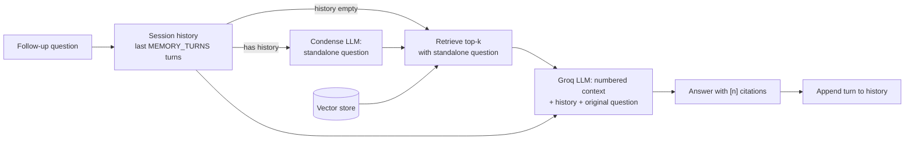

# Simple RAG + Memory

Conversational RAG. Each chat session keeps its **history**, and before retrieving, the LLM **rewrites the follow-up into a standalone question**. "Who wrote its postmortem?" becomes "Who wrote the postmortem for INC-2041?", and that is what gets embedded and searched. The answer prompt also carries the recent history, so replies read naturally in the conversation. Built with **LangChain 1.x** core primitives and **Groq** (Llama).



## What it adds over [simple-rag](../simple-rag/)

| | simple-rag | simple-rag-memory |
|---|---|---|
| Conversation | Every question stands alone | Per-session history, sliding window of `MEMORY_TURNS` turns (`trim_messages`) |
| Search query | The question as typed | The LLM-condensed **standalone question** (shown in the chat as "🔎 Searched for: …") |
| Answer prompt | Context + question | Context + **history** + question |
| Cost per follow-up | 1 LLM call | 2 LLM calls (condense + answer); the condense step can use a cheaper `REWRITE_MODEL` |

The first turn of a session has no history, so the rewrite is skipped and costs nothing. The sidebar has a **History-aware rewriting** toggle. Turn it off and ask a follow-up to see retrieval run on the raw "its"/"it" question.

On the sample data with local `bge-small` embeddings, rewriting gives a clearer top hit:

| Query | Top hit · relevance |
|---|---|
| `who wrote its postmortem?` | `incident_postmortem.docx` · 0.452 |
| `Who wrote the postmortem for incident INC-2041?` | `incident_postmortem.docx` · **0.597**, and also pulls in the support tickets |
| `how much does it cost?` | `pricing.xlsx` · 0.579 |
| `How much does the S2 robot cost?` | `pricing.xlsx` · **0.720** |

The corpus is small, so the raw follow-up still finds the right file. On a large corpus, "it" matches nothing in particular, and the rewrite is what keeps retrieval on topic.

## Design notes

- **Plain LCEL, not the legacy chains.** `create_history_aware_retriever` and `create_retrieval_chain` moved to `langchain-classic` in LangChain 1.0, and `InMemoryChatMessageHistory` is deprecated since langchain-core 1.6.4. The pipeline is two `ChatPromptTemplate | model` steps with a `MessagesPlaceholder` and a plain message list per session. Each step shows up in **Under the hood**: memory window, original vs standalone question, retrieval scores, the full prompt, and the model.
- **Rewrite output is sanitised.** Quotes and labels like `Standalone question:` are stripped, and an empty rewrite falls back to the original question.
- **Memory is per session and in-process.** Each browser tab gets its own session id, and **Clear chat** clears both the transcript and the model's memory. Memory is lost on restart, which is fine for a demo. In production you would back it with Redis, SQL or a LangGraph checkpointer.
- **Scores are normalised relevance (0–1, higher is better) on every store.** Two LangChain quirks are fixed in `vectorstore.py`:
  - FAISS's `MAX_INNER_PRODUCT` relevance mapping inverts the ranking, so the inner product is used directly.
  - LanceDB searches with L2 unless the search call names a metric, so the handle searches with cosine.
- **Ingest embeds first, then resets.** Every store is built over a `PrecomputedEmbeddings` wrapper. Ingest embeds all chunks before touching the index, so if the embedding API fails, the old index stays intact. The store then reuses those vectors instead of embedding again.

## Stack

| Part | Choice |
|---|---|
| Framework | **LangChain 1.x** (`langchain-core` LCEL, `trim_messages`) |
| LLM | **Groq** `llama-3.3-70b-versatile` (`temperature=0`); optional `REWRITE_MODEL` for the condense step |
| Chunking | `RecursiveCharacterTextSplitter`, 1000 / 150 characters |
| Embeddings | LangChain integrations: `openai`, `gemini` (768-d), `cohere`, `voyage`, `huggingface` (default `BAAI/bge-small-en-v1.5`, local) |
| Vector store | LangChain integrations: `chroma` (default), `faiss`, `qdrant-local`, `lancedb`, `pinecone`, `qdrant-cloud`, `weaviate-cloud` |
| Loaders | Same as the other folders (`.txt .md .pdf .docx .csv .xlsx .html`, plus image captions) |
| UI | Streamlit: rewrite toggle, memory counter, "Searched for" caption, Under the hood |

## Run

```bash
uv sync                                    # default stack: HF embeddings + Chroma
cp .env.example .env                       # set GROQ_API_KEY
uv run python -m simple_rag_memory.ingest  # index ../sample_data
uv run streamlit run app.py
```

Try asking "Which firmware fixed INC-2041?", then "who wrote its postmortem?", then "and what is her role?".

Optional extras: `uv sync --extra faiss`, `qdrant`, `lancedb`, `pinecone`, `weaviate`, `openai`, `gemini`, `cohere`, `voyage`, or `--extra all`. With pip: `pip install -r requirements.txt` and `pip install -e .`.

## Configuration

| Variable | Default | Notes |
|---|---|---|
| `GROQ_API_KEY` | – | Required to generate answers |
| `LLM_MODEL` | `llama-3.3-70b-versatile` | Any Groq chat model |
| `REWRITE_MODEL` | empty (= `LLM_MODEL`) | e.g. `llama-3.1-8b-instant` for a cheaper condense step |
| `MEMORY_TURNS` | `6` | Question/answer pairs kept in prompts (≥ 1) |
| `EMBEDDING_PROVIDER` / `EMBEDDING_MODEL` | `huggingface` / provider default | `openai \| gemini \| cohere \| voyage \| huggingface` |
| `OPENAI_API_KEY` / `GEMINI_API_KEY` / `COHERE_API_KEY` / `VOYAGE_API_KEY` | – | Only for that embedding provider (OpenAI is also used by fair-mode eval) |
| `VECTOR_STORE` | `chroma` | Local: `chroma \| faiss \| qdrant-local \| lancedb`; cloud: `pinecone \| qdrant-cloud \| weaviate-cloud` |
| `INDEX_DIR` | `.index` | Persistence for local stores |
| `PINECONE_*`, `QDRANT_*`, `WEAVIATE_*` | – | Cloud stores |
| `DATA_DIR` | `../sample_data` | |
| `TOP_K` | `4` | Chunks retrieved |
| `CHUNK_SIZE` / `CHUNK_OVERLAP` | `1000` / `150` | Characters |
| `EVAL_LLM`, `ANTHROPIC_API_KEY`, `EVAL_JUDGE_MODEL` | `gpt-4o-mini`, –, `claude-sonnet-5-5` | Evaluation only |

## Tests

```bash
uv sync --extra all --extra dev
uv run pytest -q          # offline: bag-of-words fake embedding + recording fake chat model
uv run ruff check . && uv run ruff format --check .
```

The pipeline tests check the control flow:
- The first turn skips the rewrite.
- A follow-up is condensed, and the *condensed* text is what gets retrieved.
- History reaches the answer prompt, and the prompt stays bounded by `MEMORY_TURNS`.
- Sessions are isolated, and the rewrite toggle works.
- An empty index makes no LLM call and stores no turn.

## Evaluation

```bash
uv sync --extra all --extra eval
uv run python eval/run_eval.py     # fair mode; needs OPENAI_API_KEY + ANTHROPIC_API_KEY
python ../scripts/compare.py       # refresh the root README table
```

Fair mode swaps Groq for the common generator (`gpt-4o-mini`) and fixes the embeddings (`bge-small`) and store (`chroma`). `--as-shipped` keeps Groq.

**Read the scores with care.** The shared question set is single-turn, and each question runs in its own fresh session, so the rewrite step never fires. These numbers measure the base pipeline (LangChain chunking plus prompt), not memory. Memory pays off on follow-ups, which the shared set doesn't contain.

<!-- EVAL_RESULTS -->
_Not run yet. Run `eval/run_eval.py` with your keys._
<!-- /EVAL_RESULTS -->

## Limitations

- **One extra LLM call per follow-up**, which adds latency and cost. A cheaper `REWRITE_MODEL` helps.
- **Rewrite errors compound.** If the condense step resolves "it" to the wrong entity, retrieval confidently fetches the wrong documents. The "Searched for" caption makes this visible.
- **Stale context.** Old turns stay in the window until they are trimmed, and a topic switch can drag earlier entities into the rewrite.
- **Sliding window only.** Facts from turns that fall out of the window are forgotten. Summary memory or retrieval over past turns would fix that.
- **Still one retrieval.** There is no reranking and no answer checking (see [advanced-rag](../advanced-rag/) and [self-rag](../self-rag/)).
