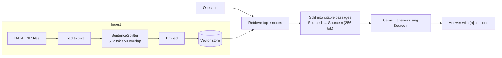

# Simple RAG

Simple RAG is the "do it properly, once" version of RAG. It splits documents into **sentence-aware chunks**, retrieves the **top-k** nodes in a single step, then splits those nodes into small numbered passages. The LLM answers with **`[n]` citations** that point at the exact passage it used. [LlamaIndex](https://docs.llamaindex.ai/) runs it: `SentenceSplitter`, `VectorStoreIndex` and `CitationQueryEngine`. Gemini generates the answers.

It is still a single step. Nothing rewrites the query, reranks hits or checks the answer.



## What it adds over [naive-rag](../naive-rag/)

| | naive-rag | simple-rag |
|---|---|---|
| Chunking | Fixed 800-character windows (cuts words and sentences) | `SentenceSplitter`: token-sized chunks that keep sentences whole |
| Citations | Whole chunks numbered `[1]..[k]` | Each hit is split into small `Source n` passages, so a citation points at a few sentences |
| Index | Hand-written store clients | LlamaIndex `VectorStoreIndex` over LlamaIndex store integrations |
| Answering | One stuffed prompt | `CitationQueryEngine` (retrieve → split → synthesize) |

## Stack

| Part | Choice |
|---|---|
| Framework | **LlamaIndex** (`llama-index-core` 0.14) |
| LLM | Google **Gemini** `gemini-flash-latest` (`temperature=0`) |
| Embeddings | LlamaIndex integrations: `openai`, `gemini` (768-d), `cohere`, `voyage`, `huggingface` (default `BAAI/bge-small-en-v1.5`, local) |
| Vector store | LlamaIndex integrations: `chroma` (default), `faiss`, `qdrant-local`, `lancedb`, `pinecone`, `qdrant-cloud`, `weaviate-cloud` |
| Loaders | Same as naive-rag (`.txt .md .pdf .docx .csv .xlsx .html`, plus image captions), so both folders index identical text |
| UI | Streamlit. **Under the hood** shows retrieve scores → citable passage count → the exact `Source n` context → model |

## Run

```bash
uv sync                             # default stack: HF embeddings + Chroma
cp .env.example .env                # set GEMINI_API_KEY
uv run python -m simple_rag.ingest  # index ../sample_data
uv run streamlit run app.py
```

Optional extras: `uv sync --extra faiss`, `qdrant`, `lancedb`, `pinecone`, `weaviate`, `openai`, `gemini`, `cohere`, `voyage`, or `--extra all`. With pip: `pip install -r requirements.txt` and `pip install -e .`.

Each embedding model gets its own index (`simple-rag-<provider>-<model>`). Opening an index with the wrong dimension gives a "re-index" error.

> **Windows note:** `pyproject.toml` sets `[tool.uv] link-mode = "copy"`. NLTK, which `SentenceSplitter` uses, refuses to open the hard-linked files that uv creates by default.

## Configuration

| Variable | Default | Notes |
|---|---|---|
| `GEMINI_API_KEY` | – | Required to generate answers (and for `gemini` embeddings) |
| `LLM_MODEL` | `gemini-flash-latest` | Rolling alias; pin a specific id if you prefer |
| `EMBEDDING_PROVIDER` / `EMBEDDING_MODEL` | `huggingface` / provider default | `openai \| gemini \| cohere \| voyage \| huggingface` |
| `OPENAI_API_KEY` / `COHERE_API_KEY` / `VOYAGE_API_KEY` | – | Only for that embedding provider (OpenAI is also used by fair-mode eval) |
| `VECTOR_STORE` | `chroma` | Local: `chroma \| faiss \| qdrant-local \| lancedb`; cloud: `pinecone \| qdrant-cloud \| weaviate-cloud` |
| `INDEX_DIR` | `.index` | Persistence for local stores (FAISS also persists the LlamaIndex docstore here) |
| `PINECONE_*`, `QDRANT_*`, `WEAVIATE_*` | – | Cloud stores |
| `DATA_DIR` | `../sample_data` | |
| `TOP_K` | `4` | Nodes retrieved |
| `CHUNK_SIZE` / `CHUNK_OVERLAP` | `512` / `50` | Tokens (`SentenceSplitter`) |
| `CITATION_CHUNK_SIZE` | `256` | Size of each citable `Source n` passage |
| `EVAL_LLM`, `ANTHROPIC_API_KEY`, `EVAL_JUDGE_MODEL` | `gpt-4o-mini`, –, `claude-sonnet-5-5` | Evaluation only |

## Tests

```bash
uv sync --extra all --extra dev
uv run pytest -q          # offline: bag-of-words fake embedding + recording fake LLM
uv run ruff check . && uv run ruff format --check .
```

## Evaluation

```bash
uv sync --extra all --extra eval
uv run python eval/run_eval.py     # fair mode; needs OPENAI_API_KEY + ANTHROPIC_API_KEY
python ../scripts/compare.py       # refresh the root README table
```

Fair mode swaps Gemini for the common generator (`gpt-4o-mini`) and fixes the embeddings (`bge-small`) and store (`chroma`), so scores compare techniques, not models. `--as-shipped` keeps Gemini.

<!-- EVAL_RESULTS -->
_Not run yet. Run `eval/run_eval.py` with your keys._
<!-- /EVAL_RESULTS -->

## Limitations

- It is still a single retrieval. Multi-hop questions such as "who wrote the postmortem for the incident 3.4.2 fixed?" need both documents to land in the top-k.
- No reranking: a semantically close but wrong node can still take a slot.
- Citations show where the LLM *says* it looked. Nothing checks that the passage actually supports the claim (see [self-rag](../self-rag/), [corrective-rag](../corrective-rag/)).
- No memory between questions (see [simple-rag-memory](../simple-rag-memory/)).
